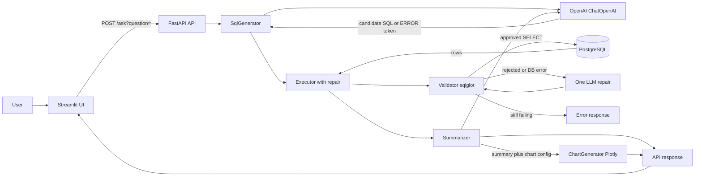

# Architecture

This document describes the **current** Talk to Data architecture. For setup and run commands, see [README.md](../README.md).

## Overview

Talk to Data accepts a question in plain English, uses LangChain with an OpenAI model (`ChatOpenAI`) to draft SQL against a **fixed Chinook-style schema** embedded in prompts, validates the SQL with `sqlglot`, executes it on a read-only PostgreSQL connection, then returns a grounded summary, optional Plotly chart JSON, and result rows.

The model never connects directly to PostgreSQL. The application owns prompts/schema text, SQL validation, execution, chart building, and result formatting.

## System diagram



Schema text and the table allowlist come from `introspection/prompts.py`, not from a live catalog query. `db.py` only provides the async engine and a connection with read-only and `statement_timeout` settings.

## Main components

| Component | Path | Responsibility |
|---|---|---|
| Streamlit UI | `app/streamlit_app.py` | Collect a question; show summary, result table, and chart. Does not display generated SQL. Falls back to a row-based Plotly chart if the API returns no figure. |
| FastAPI API | `src/talk_to_data/api.py` | `POST /ask` orchestration: generate → execute_with_repair → summarize → optional chart. |
| Config | `src/talk_to_data/config.py` | Loads `DATABASE_URL`, `OPENAI_API_KEY`, `OPENAI_CHAT_MODEL` from `.env`. |
| DB connection | `src/talk_to_data/db.py` | Async SQLAlchemy engine; sets `default_transaction_read_only` and `statement_timeout`. |
| Prompts / schema | `introspection/prompts.py` | Embedded schema string, `ALLOWED_TABLES`, few-shot examples, system prompt text. |
| SQL generator | `introspection/sql_generator.py` | NL → SQL via `ainvoke`; maps `WRITE_REQUEST` / `UNANSWERABLE`; `repair_sql` for bounded retries. |
| SQL validator | `introspection/validator.py` | One `SELECT` (query AST); block DML/DDL; allowlist tables; enforce `LIMIT`. |
| Executor | `src/talk_to_data/executor.py` | `/ask` uses `execute_with_repair` (one repair): validate/run, then LLM repair + re-validate on failure. |
| Summarizer | `src/talk_to_data/summarizer.py` | Sync structured LLM output: textual summary plus chart config (`should_visualize`, type, x, y, title). |
| Chart builder | `src/talk_to_data/charts.py` | Build Plotly bar/line/scatter/pie from the summarizer’s chart config. |
| Evaluation | `eval/run_eval.py` | HTTP contract/smoke checks against `/ask` using `eval/questions.json` (no reference-SQL result comparison yet). |

## Request flow

1. The user submits a question in Streamlit.
2. Streamlit `POST`s to `http://localhost:8000/ask` with query parameter `question`.
3. `SqlGenerator.generate_sql` sends the fixed system prompt (schema + rules + few-shots) and the question to `ChatOpenAI`.
4. If the model returns `WRITE_REQUEST` or `UNANSWERABLE`, the API returns `{ "result": "ERROR", "message": "…" }` and Streamlit shows that message.
5. On success, `Executor.execute_with_repair` validates and runs the SQL. On `UnsafeQueryError` or `DBAPIError`, it requests one repaired `SELECT` via `repair_sql`, re-validates, and retries once (`max_retries=1`). Exhausted retries become `QueryFailedError`.
6. Rows become a DataFrame; `Summarizer.analyze` (sync `.invoke`) produces a summary and chart config from a bounded preview of rows.
7. If `should_visualize` is true, `ChartGenerator.generate_chart` builds a Plotly figure; the API returns `chart.to_json()` or `null`.
8. FastAPI returns `{ "summary", "chart", "data", "retries" }` where `data` is a list of row dicts and `retries` is `0` or `1`.
9. Streamlit renders summary, dataframe, and chart (API figure or local fallback from rows).

## API request and response shape

**Request:** `POST /ask?question=<natural language question>`

**Success:**

```json
{
  "summary": "The first artist has the most tracks in the returned results.",
  "chart": "{…plotly figure json…}",
  "data": [
    {"artist_name": "Example Artist", "track_count": 42}
  ],
  "retries": 0
}
```

`chart` may be `null` when the summarizer chooses not to visualize. `retries` counts successful repair attempts used before a valid result (`0` or `1` with the current API setting).

**Model refusal / write attempt:**

```json
{
  "result": "ERROR",
  "message": "That question cannot be answered from this database."
}
```

Validation failures during execution may return `{ "message": "…" }` without a `summary` field; Streamlit treats missing `summary` as an invalid success payload unless `result` is `ERROR`.

The API does not currently return the generated SQL, a separate `columns` list, or a chart spec of the form `{ "type", "x", "y" }`.

## Safety boundaries

What the code enforces today:

- Session `default_transaction_read_only = on` and `statement_timeout = '5s'` on the app connection.
- `sqlglot` parse: exactly one statement; must be a `SELECT`-style query; reject DML/DDL/commands/`SELECT INTO`.
- Table names checked against the fixed `ALLOWED_TABLES` set; non-`public` schema qualification rejected.
- Missing or oversized `LIMIT` capped (default max 1000 rows).
- Model never receives a DB connection; only a markdown preview of result rows goes to the summarizer.
- Treat model output, DB errors, and user questions as untrusted.

Recommended operations practice (not fully automated by the app):

- Use a PostgreSQL role limited to `CONNECT`, schema `USAGE`, and `SELECT` on approved tables.
- Prefer bound parameters for any future user-supplied literals; do not interpolate untrusted values into SQL text.

SQL validation is defense in depth; database permissions remain the final enforcement boundary.

## Project structure

```text
talk-to-data/
├── src/talk_to_data/
│   ├── config.py
│   ├── db.py                 # Async engine, read-only connection, timeout
│   ├── api.py                # POST /ask orchestration
│   ├── executor.py           # Validate + execute with one bounded repair
│   ├── charts.py             # Plotly builders from LLM chart config
│   └── summarizer.py         # Summary + chart config via ChatOpenAI
├── introspection/
│   ├── prompts.py            # Embedded schema, allowlist, prompts
│   ├── sql_generator.py      # NL → SQL and repair_sql
│   └── validator.py          # SELECT / allowlist / LIMIT checks
├── app/
│   └── streamlit_app.py
├── eval/
│   ├── questions.json
│   └── run_eval.py
├── data/                     # Optional local sample data
├── scripts/                  # Setup helpers not filled in yet
├── tests/                    # Not populated yet
├── docs/
│   └── DESIGN.MD
├── .env.example
├── .gitignore
├── pyproject.toml
├── uv.lock
├── LICENSE
└── README.md
```

## Scope and known gaps

- PostgreSQL only; single-user; no authentication.
- Schema context is a hardcoded Chinook-like (lowercase snake_case) description, not live introspection.
- Chart selection is LLM-driven in the summarizer; Streamlit may derive a fallback chart from rows.
- SQL safety checks are deterministic application code; chart choice is not.
- Repair is bounded to one retry on the `/ask` path; every repaired candidate is re-validated.
- Evaluation is API contract/smoke testing, not execution accuracy versus reference SQL.
- Generated SQL is not exposed in the API response or UI.
- Automated tests and data-download helpers are incomplete.

Possible later work (not implemented): live schema inspection, package consolidation under `src/talk_to_data/`, showing SQL in the UI, deterministic chart rules in the API, result-vs-reference eval, schema selection for large DBs, CSV upload, conversation memory, semantic layer.
