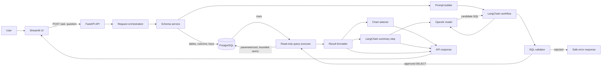

# Architecture

## Overview

Talk to Data accepts a question in plain English, uses LangChain with an OpenAI model to draft SQL for the inspected PostgreSQL schema, validates the SQL, executes it with a read-only database role, and returns the query, tabular results, a suitable visualization, and a short summary based on the returned rows.

The model never connects directly to PostgreSQL. The application owns schema access, SQL validation, execution, and result formatting.

## System diagram



## Main components

| Component | Responsibility |
|---|---|
| Streamlit UI | Collect a question and display the SQL, table, chart, and summary. |
| FastAPI API | Validate request shape, call the analysis pipeline, return a structured response. |
| Request orchestration (`api.py`) | Coordinate schema retrieval, generation, validation, execution, charting, and summarization. |
| PostgreSQL schema service | Read allowed schema metadata: table names, columns, types, and foreign keys. Optionally select relevant tables for each question. |
| Prompt builder | Provide the question, relevant schema, SQL dialect, rules, and examples to LangChain. |
| LangChain + `ChatOpenAI` (`sql_generator.py`, `summarizer.py`) | Generate candidate SQL and summarize only the query results supplied by the app. Use async calls from async endpoints. |
| SQL validator | Parse SQL with `sqlglot`; accept one read-only `SELECT`; check referenced tables; enforce limits and reject unsupported constructs. |
| Query executor | Run validated SQL using SQLAlchemy's async engine and a PostgreSQL role with read-only permissions. Apply a database-side timeout. |
| Chart selector | Use deterministic rules to choose a metric, bar chart, line chart, or plain table. |
| Evaluation runner | Compare generated query results with reference SQL results and record validity, accuracy, repair rate, and latency. |

## Request flow

1. The user submits a question through Streamlit.
2. Streamlit sends the question to `POST /ask` on FastAPI.
3. The API checks basic request constraints and starts the analysis pipeline.
4. The schema service reads permitted metadata from PostgreSQL. It may narrow the context to relevant tables to keep prompts focused.
5. LangChain sends the schema and question to `ChatOpenAI`, requesting SQL only in a defined format.
6. The validator parses the candidate SQL and rejects invalid, multi-statement, or non-read-only queries. It checks table names and applies a maximum row count.
7. The executor runs only validated SQL using the read-only role, with a statement timeout. If enabled, one bounded repair attempt can use the database error message to request corrected SQL; every retry goes through validation again.
8. The app formats rows for JSON and selects a chart using predictable rules. The model receives only a bounded sample of actual result rows for the written summary.
9. FastAPI returns the question, validated SQL, columns, rows, chart specification, summary, and optional timing metadata.
10. Streamlit renders the answer. If the question cannot be answered from the schema or data, the API returns a clear refusal or explanation.

## API response shape

Example response for a successful request:

```json
{
  "question": "Which artists have the most tracks?",
  "sql": "SELECT ... LIMIT 1000",
  "columns": ["artist_name", "track_count"],
  "rows": [
    {"artist_name": "Example Artist", "track_count": 42}
  ],
  "chart": {
    "type": "bar",
    "x": "artist_name",
    "y": "track_count"
  },
  "summary": "The first artist has the most tracks in the returned results."
}
```

The example values are illustrative, not actual Chinook query output.

## Safety boundaries

- Use a dedicated PostgreSQL application role for query execution. Grant it only `CONNECT`, schema `USAGE`, and `SELECT` on approved tables.
- Keep schema discovery and query execution restricted to the intended schema, initially `public`.
- Require a single parsed `SELECT` statement. Reject writes, DDL, administrative commands, stacked statements, and unsupported constructs.
- Check tables against the inspected allowlist. Enforce a row limit even if the model omits one.
- Use bound parameters for any user-supplied values. Do not interpolate values into SQL text.
- Set PostgreSQL `statement_timeout`; app-side cancellation alone is not a sufficient query limit.
- Never execute SQL returned by the model before validation. Never let the model call the database directly.
- Send only bounded result data to the summarizer and instruct it to report only facts supported by those rows.
- Treat model output, database error messages, and user questions as untrusted input.

SQL parsing and validation provide defense in depth; database permissions are the final enforcement boundary.

## Project structure

This follows the repository structure defined for the project. The request orchestration lives in `api.py`; the LangChain prompt templates live in `prompts.py`, SQL generation in `sql_generator.py`, and result-grounded summaries in `summarizer.py`.

```text
talk-to-data/
├── src/talk_to_data/
│   ├── config.py
│   ├── db.py                 # PostgreSQL connection (read-only), schema introspection
│   ├── prompts.py            # LangChain prompts and few-shot examples
│   ├── sql_generator.py      # Natural language to SQL with LangChain/OpenAI
│   ├── validator.py          # SELECT-only checks, LIMIT, allowed tables
│   ├── executor.py           # Execute validated SQL, return DataFrame
│   ├── charts.py             # Choose and build chart
│   ├── summarizer.py         # Summarize actual query results with LangChain/OpenAI
│   └── api.py                # FastAPI endpoints and request orchestration
├── app/                      # Streamlit UI
├── data/                     # Optional local sample data
├── scripts/
│   └── download_data.py
├── eval/
│   ├── questions.json        # Questions and reference SQL
│   └── run_eval.py
├── tests/
├── docs/
│   ├── architecture.md
│   └── design.md
├── .env.example
├── .gitignore
├── pyproject.toml
├── LICENSE
├── CHANGELOG.md
└── README.md
```
## Initial scope and trade-offs

- PostgreSQL is the first supported database dialect.
- The first release is single-user and does not include authentication.
- SQL generation is model-assisted, but chart selection and SQL safety checks use deterministic application code.
- Chinook is a development/evaluation dataset. Do not bundle it until its license and attribution requirements have been reviewed.
- Evaluation should measure result correctness, not exact SQL-string matches.

